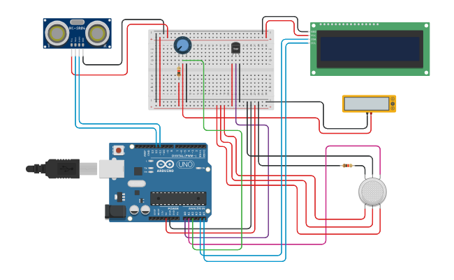

 <div align="center">

# 🌦️ Weather Monitoring System

</div>


## 📌 Overview

This project demonstrates a **sensor-based weather monitoring system** using an Arduino, temperature sensor, gas sensor, wind speed sensor, ultrasonic sensor, and 16×2 I2C LCD. The system reads sensor values, calculates temperature and wind speed, measures distance, and displays alert messages when predefined conditions are met.

The project demonstrates how multiple sensor inputs can be processed by a microcontroller to provide a simple monitoring and alert system.


## 🎯 Objective

- To monitor temperature, gas sensor readings, and wind speed using Arduino.
- To display sensor-related alerts on an LCD.
- To implement threshold-based monitoring using conditional statements.
- To understand sensor interfacing and basic automation with a microcontroller.


## 🧰 Apparatus

### 🛠️ Hardware Requirements

- Arduino Uno
- Analog Temperature Sensor
- Gas Sensor
- Wind Speed Sensor
- HC-SR04 Ultrasonic Sensor
- 16×2 I2C LCD
- Breadboard
- Jumper Wires
- USB Cable
- Power Supply

### 💻 Software Requirements

- Arduino IDE
- Simulation Tool (Tinkercad / Wokwi)


## 🔌 Pin Configuration

| Component | Arduino Connection |
|---|---|
| Temperature Sensor Output | A0 |
| Gas Sensor Output | A1 |
| Wind Speed Sensor Output | A2 |
| Ultrasonic Sensor TRIG | D12 |
| Ultrasonic Sensor ECHO | D11 |
| LCD SDA | A4 |
| LCD SCL | A5 |
| LCD I2C Address | `0x23` |

**Note :** Connect VCC and GND according to the specifications of each component.


## 📷 Circuit Diagram



🔗 **[View Live Simulation on Tinkercad](YOUR_TINKERCAD_LINK)**


## </> Source Code

The Arduino source code for this experiment is available in the [`Weather_Monitoring_System.ino`](Weather_Monitoring_System.ino) file included in this folder.

The program reads sensor values, calculates temperature and wind speed, measures ultrasonic distance, and displays alert messages on the LCD when the corresponding conditions are met.


## ⚙️ Working Principle

The Arduino reads analog values from the temperature, gas, and wind speed sensors. It also measures distance using the ultrasonic sensor. The readings are processed and checked against predefined threshold conditions.

| Condition | LCD Output |
|---|---|
| Temperature > 35°C | Temperature value and `Temperature High` |
| Gas sensor reading > 200 | `Gas Detected!` and sensor reading |
| Wind speed > 10 mph | `Wind ALERT!` and wind speed |
| Ultrasonic distance < 100 cm | `Rain ALERT!` and measured distance |

When a condition is satisfied, the corresponding message is displayed on the LCD. Each alert includes a 2-second delay, after which the program continues checking the remaining conditions.

**Important :** The current implementation triggers `Rain ALERT!` based on ultrasonic distance. It does not directly detect rainfall; a dedicated rain sensor would be needed for actual rain detection.


## 📁 Project Files

```text
Weather Monitoring System/
│
├── Weather_Monitoring_System.ino
├── Circuit_Diagram.png
└── README.md
```


